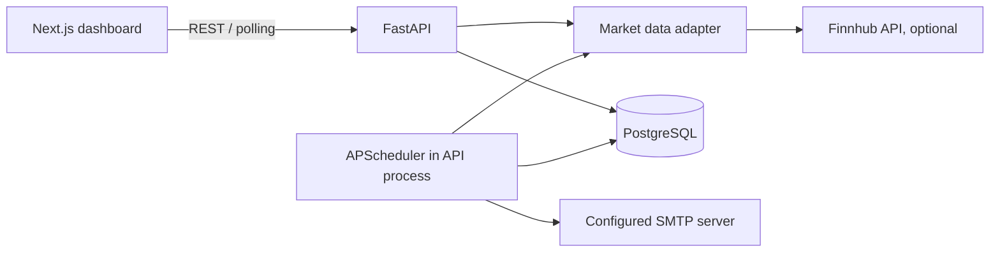

# MarketPulse

MarketPulse is a self-hostable market activity scanner and premarket report service. It is a research tool, not investment advice or an order-entry system. Without configured credentials it runs in explicitly labeled demo mode; demo fixtures are never described as live market data.

## Architecture



See [docs/architecture.md](docs/architecture.md) for boundaries, data limitations, and rollout notes.

## Start locally

Requirements: Docker Desktop with Compose. Copy `.env.example` to `.env` and set secrets only if using live data or email. The no-key default is demo mode.

```powershell
Copy-Item .env.example .env
docker compose up --build
```

Open `http://localhost:3000`; the API and interactive OpenAPI docs are at `http://localhost:8000` and `http://localhost:8000/docs`.

```powershell
docker compose logs -f
docker compose down
docker compose down -v # removes local development database data
docker compose exec api pytest
```

Local API-only development (Python 3.11+):

```powershell
py -m venv .venv
.\.venv\Scripts\Activate.ps1
pip install -r backend\requirements.txt
uvicorn app.main:app --app-dir backend --reload
```

## Configuration

| Variable | Purpose |
| --- | --- |
| `DATABASE_URL` | SQLAlchemy URL; Compose uses PostgreSQL. Defaults to local SQLite for API-only development. |
| `FINNHUB_API_KEY` | Optional Finnhub key. Live quote and intraday candle access depends on the account plan and applicable exchange entitlements. |
| `ADMIN_API_KEY` | Optional local admin API key; required when `APP_ENV=production`. Enter it in Settings for private watchlist, alert, and report controls. |
| `MARKET_SYMBOLS` | Comma-separated symbols to scan; default is a small liquid-symbol universe, not the whole exchange. |
| `SMTP_HOST`, `SMTP_PORT`, `SMTP_USERNAME`, `SMTP_PASSWORD`, `SMTP_FROM` | Optional SMTP delivery configuration. |
| `REPORT_RECIPIENT` | Optional initial recipient; configurable through the settings API. |
| `DASHBOARD_URL` | Link included in reports. |
| `CORS_ORIGINS` | Allowed browser origins, comma-separated. |
| `REFRESH_SECONDS` | Dashboard refresh interval. |
| `REPORT_TIME` | Daily report time in `HH:MM` America/New_York; defaults to `08:00`. |

See `.env.example` for the complete placeholder configuration. Never commit `.env`.

## Provider and licensing notes

The Finnhub adapter uses its documented quote, stock-candle, and company-news REST endpoints. Consult [Finnhub API documentation](https://finnhub.io/docs/api) and its current pricing, exchange coverage, redistribution, retention, and display terms before deployment. A valid API key does not by itself imply real-time exchange entitlements. MarketPulse labels provider-backed values by source and timestamp and reports unsupported premarket data rather than inferring it from regular-session bars. The provider's quote/candle rate limits are respected with bounded concurrency and request caching; tune the symbol universe and refresh interval to the account limits.

Premarket trade coverage, index coverage, news licensing, real-time status, and early-close behavior depend on the provider plan. No provider outage is hidden by falling back to demo fixtures. The app does not scrape exchange or publisher pages. SEC company submissions and XBRL APIs are described at [SEC EDGAR APIs](https://www.sec.gov/edgar/sec-api-documentation); use a descriptive `User-Agent` and comply with SEC fair-access guidance before adding that adapter. See [docs/data-sources.md](docs/data-sources.md).

## Tests and CI

```powershell
docker compose exec api pytest
npm --prefix frontend run test
npm --prefix frontend run lint
```

The GitHub Actions workflow runs backend and frontend checks without paid data access or real email delivery.

## Operations

The API exposes `/api/health`, including database and provider status. OpenAPI is available at `/docs`. Configure backups for PostgreSQL and restrict network access to the database. Report payloads, settings, watchlists, and alert history are retained; live quotes, provider payloads, and licensed bar history are not persisted by default. For production, run behind TLS, set a restrictive CORS origin, provision secrets through a secret manager, and use one scheduler-enabled API replica (the database report uniqueness constraint prevents duplicate scheduled reports, but does not make multiple schedulers desirable).

This initial deployment is single-user and has no public signup. Protect the service with private network access or an identity-aware proxy before exposing administrative endpoints.